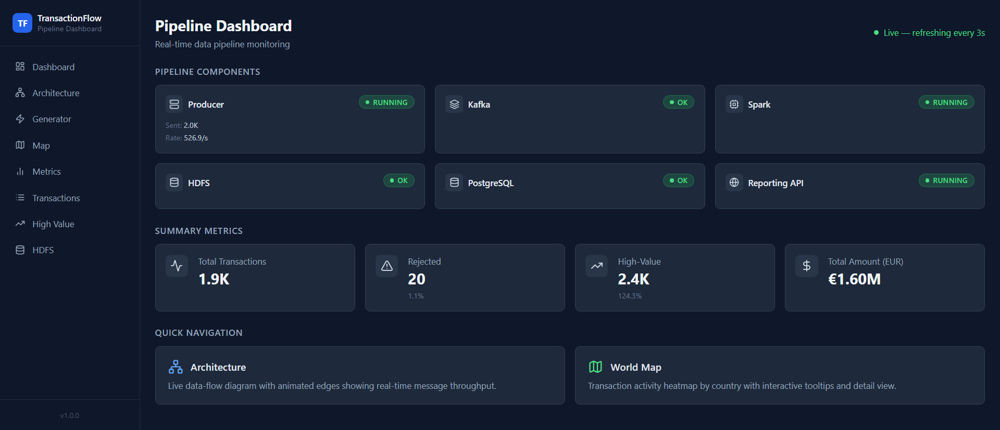
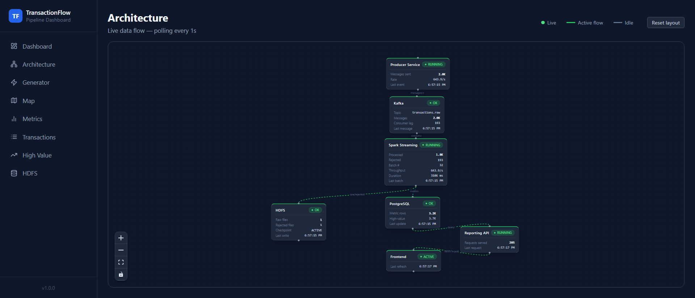
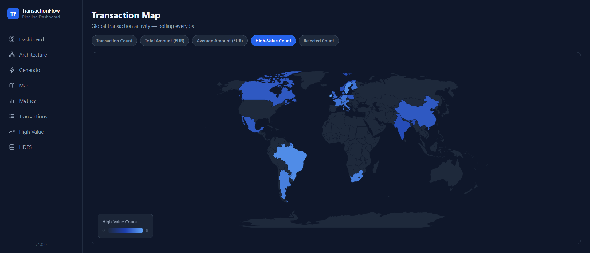
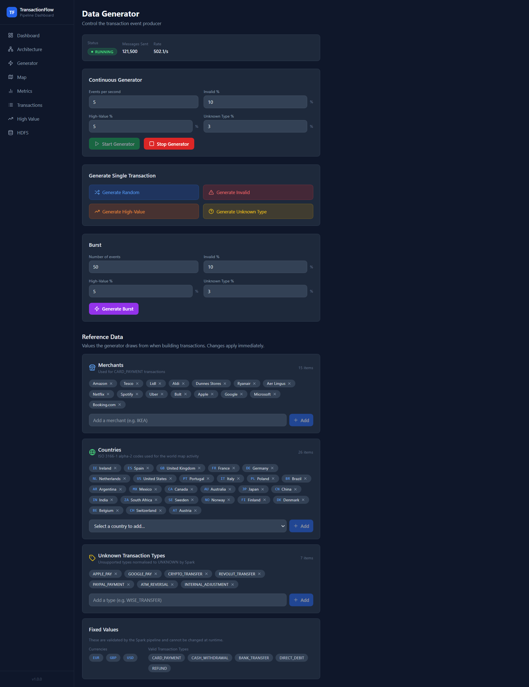
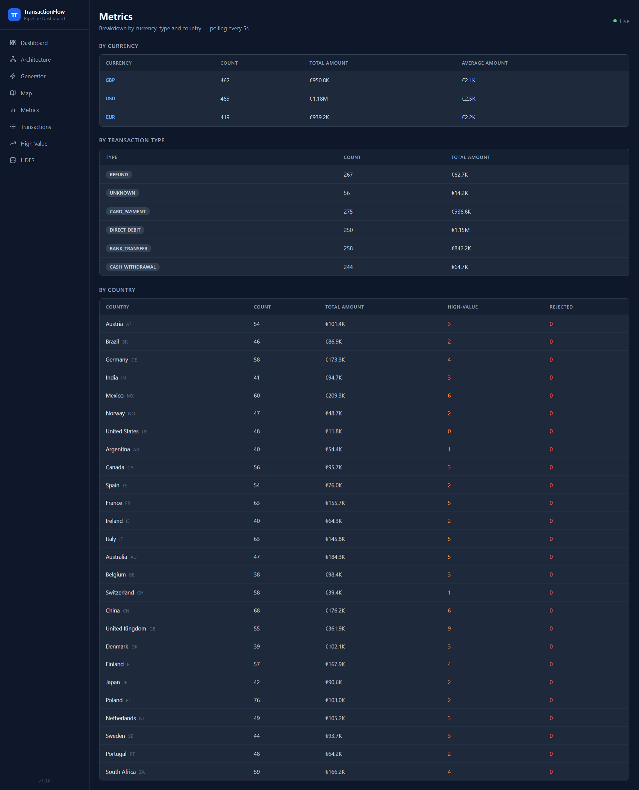
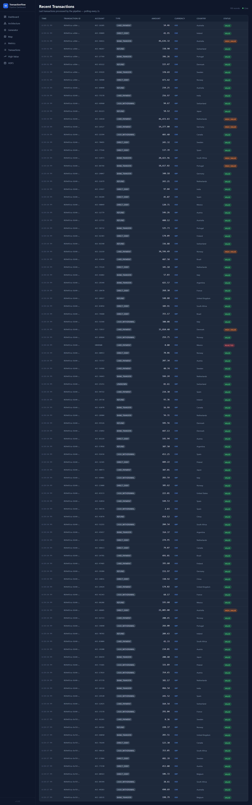
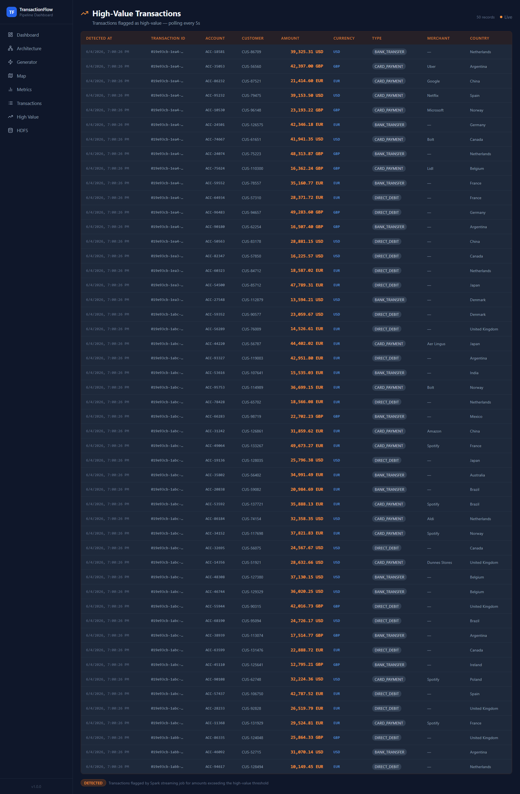
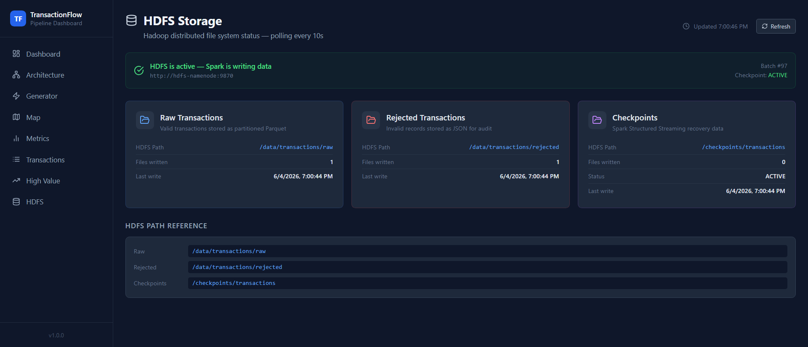

# TransactionFlow Data Pipeline

A Docker-based, end-to-end **financial transaction data pipeline** built to demonstrate a classic data-engineering stack: **Kafka → Spark Structured Streaming → HDFS + PostgreSQL → REST API → live Next.js dashboard**.

The cluster topology runs entirely inside Docker containers and demonstrates a **minimum viable three-node architecture**: 1 Spark master + 2 Spark workers, 1 HDFS NameNode + 2 HDFS DataNodes.

A Spring Boot producer generates random transaction events and publishes them to Kafka. A Spark Structured Streaming job consumes the stream, validates and normalises records, writes raw/rejected data to HDFS as Parquet/JSON, computes aggregations, and writes curated metrics to PostgreSQL. A Spring Boot reporting API serves those metrics to a Next.js dashboard with a live architecture diagram and a world map of transaction activity.

---

## Screenshots

### Dashboard
Pipeline component status cards and summary metrics, refreshing live.



### Architecture & Live Data Flow
React Flow diagram with per-node live counters and animated edges. Nodes are draggable and the layout is saved to the browser.



### Transaction Map
World map shaded by activity per country, switchable between transaction count, total/average amount, high-value, and rejected counts.



### Data Generator
Start/stop the generator, fire single transactions or bursts, and edit the reference-data lists (merchants, ISO countries, unknown types).



### Metrics
Aggregations by currency, transaction type, and country.



### Recent Transactions
Live feed of processed transactions with colour-coded status badges.



### High-Value Transactions
Transactions detected above the high-value threshold.



### HDFS Storage
HDFS paths, file counts, and checkpoint status.



---

## Architecture

```
[Producer Service]  ── transactions.raw ──▶  [Kafka]
                                                │
                                                ▼
                                       [Spark Streaming Job]
                                          │            │
                            raw / rejected│            │ metrics / high-value
                                          ▼            ▼
                                       [HDFS]      [PostgreSQL]
                                                       │
                                                       ▼
                                              [Reporting API]
                                                       │
                                                       ▼
                                               [Next.js Frontend]
```

**Data flow:**
1. Producer generates transactions (UUIDv7 IDs) and publishes JSON to Kafka topic `transactions.raw`.
2. Spark consumes the topic, parses against a strict schema, validates records, and normalises unsupported transaction types to `UNKNOWN`.
3. Valid records → HDFS as **Parquet** (partitioned `year=/month=/day=`). Rejected records → HDFS as **JSON** with rejection reasons.
4. Aggregations (by currency, type, country), high-value transactions (≥ 10,000), and recent transactions → **PostgreSQL**.
5. Spark checkpoints live in HDFS.
6. The reporting API queries PostgreSQL and exposes metrics, pipeline status, and map data.
7. The frontend polls the API and renders the dashboard, animated data-flow diagram, and world map.

---

## Technology Stack

| Layer | Technology |
|---|---|
| Producer / Reporting services | Java 21, Spring Boot 3.2, Spring Web, Spring Kafka, Spring Data JPA |
| Stream processing | Apache Spark 3.5 (Structured Streaming), Java 11 |
| Messaging | Apache Kafka 3.7 (KRaft mode, no ZooKeeper) |
| Storage | Hadoop HDFS (bde2020 images), Parquet |
| Serving database | PostgreSQL 17 |
| Frontend | Next.js 15, React 18, TypeScript, Tailwind CSS, React Flow, react-simple-maps |
| Infrastructure | Docker Compose |
| UUIDs | UUID **v7** (time-ordered) via `com.github.f4b6a3:uuid-creator` |

---

## Prerequisites

- **Docker Desktop** (the only thing you need installed). No local Java, Maven, Node.js, Kafka, Spark, Hadoop, or PostgreSQL required.
- ~8–10 GB of RAM available to Docker is recommended (2 Spark workers + 2 HDFS DataNodes + Kafka + 3 app builds).

---

## Quick Start

From the project root (`C:\projects\transactionflow`):

```bash
# Build images and start the whole stack
docker compose up --build

# Or run detached (in the background)
docker compose up --build -d
```

First start takes several minutes (Maven builds, npm install, image pulls). The startup order is handled by health checks and `depends_on`:

```
kafka + postgres + hdfs-namenode      →  (healthy)
kafka-init + hdfs-init                →  create topics / directories, then exit 0
spark-master + spark-worker-1/2       →  start (2 workers register with master)
hdfs-datanode-1/2                     →  start (2 DataNodes register with NameNode)
producer + reporting + frontend       →  start
spark-streaming-job                   →  waits for Kafka + HDFS + Postgres + both workers, then streams
```

Once everything is up, **start generating data** (nothing flows until the generator runs):

```bash
curl -X POST http://localhost:8081/api/generator/start ^
  -H "Content-Type: application/json" ^
  -d "{\"eventsPerSecond\":5,\"invalidPercentage\":2,\"highValuePercentage\":1,\"unknownTypePercentage\":3}"
```

Then open the dashboard at **http://localhost:3000**.

> On macOS/Linux replace the `^` line-continuation with `\` and use single quotes for the JSON body.

---

## Cluster Verification

After `docker compose up`, confirm the full cluster is live with these commands:

### 1 — All containers running

```bash
docker compose ps
```

Expected: 15 services all showing `running` (or `exited 0` for the two init jobs). You should see:
- `transactionflow-spark-worker-1`
- `transactionflow-spark-worker-2`
- `transactionflow-hdfs-datanode-1`
- `transactionflow-hdfs-datanode-2`

### 2 — Spark Master shows 2 live workers

Open **http://localhost:8080** in your browser and look for **2 Workers** listed in the _Workers_ table, both in `ALIVE` state.

Or query the REST API (available in Spark 3.x with the history-server API):

```bash
# Workers appear as Alive Workers: 2 in the master web UI
start http://localhost:8080
```

### 3 — HDFS shows 2 live DataNodes

```bash
docker exec transactionflow-hdfs-namenode hdfs dfsadmin -report
```

Look for:

```
Live datanodes (2):
```

and two blocks — one for `hdfs-datanode-1` and one for `hdfs-datanode-2`.

---

## Professor Demonstration: Distributed HDFS Storage

This section shows how to prove that TransactionFlow writes data in a **genuinely distributed** fashion across **two physical HDFS DataNodes**.

### Why replication factor 2 matters

With `HDFS_REPLICATION=2` (set in `.env` / `.env.example`) and two live DataNodes, every HDFS block is written to **both** DataNodes.  This means:

- If one DataNode container dies, no data is lost (the other holds a complete copy).
- The `hdfs fsck -files -blocks -locations` output will list **two block replicas**, each pinned to a different DataNode.

For replication to work, **both DataNode containers must be running and registered** before data is written.

---

### Step 1 — Generate enough data

```bash
# Windows PowerShell / CMD (replace ^ with \ on Linux/macOS)
curl -X POST http://localhost:8081/api/generator/burst ^
  -H "Content-Type: application/json" ^
  -d "{\"numberOfEvents\":500,\"invalidPercentage\":5,\"highValuePercentage\":2,\"unknownTypePercentage\":3}"
```

Wait ~30 seconds for the Spark streaming job to complete a batch.

---

### Step 2 — Confirm two live DataNodes (cluster health proof)

```bash
docker exec transactionflow-hdfs-namenode hdfs dfsadmin -report
```

Look for:

```
Live datanodes (2):
```

This proves the HDFS cluster has two registered, healthy nodes.  It does **not** yet prove that files exist or that blocks are distributed.

---

### Step 3 — List HDFS output (file existence proof)

```bash
docker exec transactionflow-hdfs-namenode hdfs dfs -ls -R /data/transactionflow
```

Expected output includes Parquet part files under:
- `/data/transactionflow/raw/transactions/year=.../month=.../day=.../`
- `/data/transactionflow/rejected/transactions/` (if any invalid events were sent)
- `/data/transactionflow/checkpoints/` (Spark recovery data)

This proves files **exist** on HDFS.  It does not prove which DataNodes hold the blocks.

---

### Step 4 — Inspect block distribution (replication proof)

```bash
docker exec transactionflow-hdfs-namenode \
  hdfs fsck /data/transactionflow/raw/transactions \
  -files -blocks -locations
```

Look for a section like:

```
/data/transactionflow/raw/transactions/year=.../part-00000-....parquet:
  Under replicated BP-...: ...
  Block BP-...: blk_12345 ...
    0. BP-.../hdfs-datanode-1:9866
    1. BP-.../hdfs-datanode-2:9866
```

**Two block locations (one per DataNode) = distributed storage proven.**

For rejected files (if any):

```bash
docker exec transactionflow-hdfs-namenode \
  hdfs fsck /data/transactionflow/rejected/transactions \
  -files -blocks -locations
```

---

### Step 5 — Automated evidence capture

Run the bundled script from the project root:

```powershell
.\scripts\capture-hdfs-distribution.ps1
```

This creates a timestamped directory under `docs/evidence/run_<timestamp>/` containing:

| File | What it proves |
|---|---|
| `01_compose_ps.txt` | All containers running |
| `02_dfsadmin_report.txt` | DataNode count + health |
| `03_ls_recursive.txt` | File **existence** under canonical paths |
| `04_fsck_raw.txt` | Block **distribution** across DataNodes |
| `05_fsck_rejected.txt` | Block distribution for rejected files |

Evidence directories are git-ignored (`docs/evidence/run_*`); only the `.gitkeep` placeholder is committed.

---

## Professor Demonstration: Distributed Spark Execution

This section shows how to prove that the Spark Structured Streaming job runs in **cluster mode across two workers**, distributes executor tasks between them, and produces real analytics outputs.

### Cluster mode enforcement

`spark-jobs/entrypoint.sh` always submits to `spark://spark-master:7077`.  If `SPARK_MASTER_URL` is empty or set to a `local[…]` URL the script exits immediately with a clear error — there is no silent degradation to single-process mode.

Spark submit flags for the two-worker Docker cluster:

| Flag | Value | Reason |
|---|---|---|
| `--master` | `spark://spark-master:7077` | Always cluster mode |
| `--executor-memory` | `1g` | Fits inside the 2 G worker budget |
| `--executor-cores` | `1` | One core per executor → one executor per worker |
| `--conf spark.cores.max` | `2` | Cap prevents one worker monopolising all cores |
| `--conf spark.sql.shuffle.partitions` | `4` | Low overhead for a 2-worker cluster |

---

### Step 1 — Start the stack

```bash
docker compose up -d --build
```

Wait ~3–5 minutes on first run (Maven build + image pulls).

---

### Step 2 — Confirm two live Spark workers

**Option A — Spark Master UI (visual proof)**

Open **http://localhost:8080** and look for the **Workers** table showing two workers in `ALIVE` state.

**Option B — Spark Master REST API**

```bash
curl http://localhost:8080/json
```

The JSON response contains a `workers` array.  Count entries with `"state":"ALIVE"`.  Expected: **2**.

**Option C — Container logs**

```bash
docker compose logs --tail=50 spark-master
```

Look for two lines matching:

```
Registering worker ... with ... cores, ... memory
```

---

### Step 3 — Generate a large workload

```bash
# Windows CMD / PowerShell (replace ^ with \ on Linux/macOS)
curl -X POST http://localhost:8081/api/generator/burst ^
  -H "Content-Type: application/json" ^
  -d "{\"numberOfEvents\":10000,\"invalidPercentage\":5,\"highValuePercentage\":2,\"unknownTypePercentage\":3}"
```

This sends 10,000 events: ~9,500 valid + ~500 invalid.  With `spark.cores.max=2` and Kafka topic partitioned into 3, tasks will be split across both executors.

Wait **~60 seconds** for Spark to process the batch.

---

### Step 4 — Confirm distributed execution

**Streaming job logs (batch processing across executors)**

```bash
docker compose logs --tail=50 spark-streaming-job
```

Look for lines like:

```
Batch 5: processing 10000 records.
Batch 5: valid=9500 rejected=500
Batch 5: completed in 12345 ms.
```

**Worker-1 executor launch**

```bash
docker compose logs --tail=30 spark-worker-1
```

Look for `ExecutorRunner` launch messages.

**Worker-2 executor launch**

```bash
docker compose logs --tail=30 spark-worker-2
```

Both workers should show executor activity for the same application ID.

---

### Step 5 — Check analytics output

```bash
# Metrics summary (proves PostgreSQL analytics were written)
curl http://localhost:8082/api/metrics/summary

# Recent transactions (proves records were processed end-to-end)
curl http://localhost:8082/api/transactions/recent

# HDFS output (proves distributed file writes)
docker exec transactionflow-hdfs-namenode hdfs dfs -ls -R /data/transactionflow/raw/transactions
```

---

### Step 6 — Automated evidence capture

```powershell
# Basic verification
.\scripts\verify-spark-cluster.ps1

# Verification + automatic burst of 10 000 transactions
.\scripts\verify-spark-cluster.ps1 -RunBurst -BurstSize 10000
```

Creates `docs/evidence/spark_run_<timestamp>/` with:

| File | What it proves |
|---|---|
| `01_compose_ps.txt` | All containers running |
| `02_spark_master_log.txt` | Worker **registration** messages |
| `03_spark_master_api.txt` | Master state JSON: workers[], activeApps[] |
| `04_streaming_job_log.txt` | Batch processing + cluster mode (not `local`) |
| `05_spark_worker1_log.txt` | Executor launched on **worker-1** |
| `06_spark_worker2_log.txt` | Executor launched on **worker-2** |
| `07_reporting_metrics.txt` | Analytics results (proves data was processed) |
| `08_reporting_pipeline.txt` | Pipeline component health |

**Proof chain:**

```
02/03  →  cluster membership    (workers are ALIVE and registered)
04     →  application mode      (runs on spark://…, not local)
05/06  →  both workers active   (executor launched on each worker)
07/08  →  results               (real analytics from real data)
```

---

## Stopping & Cleaning Up

```bash
# Stop containers (keeps data volumes)
docker compose down

# Stop AND delete all data (Kafka, Postgres, HDFS volumes)
docker compose down -v

# Rebuild a single service after a code change
docker compose build producer-service
docker compose up -d producer-service

# Tail logs
docker compose logs -f spark-streaming-job
docker compose logs -f producer-service reporting-service frontend
```

---

## Web UIs & Ports

| Service | URL | Notes |
|---|---|---|
| **Frontend Dashboard** | http://localhost:3000 | Main UI |
| Producer API | http://localhost:8081 | Generator REST API |
| Reporting API | http://localhost:8082 | Metrics / pipeline REST API |
| Kafka UI | http://localhost:8085 | Inspect topics & messages |
| Spark Master UI | http://localhost:8080 | Spark cluster status |
| HDFS NameNode UI | http://localhost:9870 | Browse HDFS files |
| Adminer | http://localhost:8086 | PostgreSQL web client |
| Kafka broker | `localhost:9092` | — |
| PostgreSQL | `localhost:5432` | — |

**Adminer / PostgreSQL login** (local dev credentials only — see Security note):

```
System:   PostgreSQL
Server:   postgres
Username: transactionflow
Password: transactionflow
Database: transactionflow
```

All ports and credentials live in the root **`.env`** file — change them there and they propagate to every service via `docker-compose.yml`.

---

## Frontend Pages

| Page | Path | Description |
|---|---|---|
| Dashboard | `/` | Pipeline status cards + summary metrics |
| Architecture | `/architecture` | Live React Flow diagram with animated edges; nodes are **draggable** and the layout is **saved to your browser** |
| Generator | `/generator` | Start/stop the generator, single-shot generation, bursts, and **editable reference-data lists** (merchants, ISO countries, unknown types) |
| Map | `/map` | World map shaded by transaction activity per country |
| Metrics | `/metrics` | Tables by currency, type, and country |
| Transactions | `/transactions` | Recent transactions with status badges |
| High Value | `/high-value` | Detected high-value transactions (≥ 10,000) |
| HDFS | `/hdfs` | HDFS paths, file counts, checkpoint status |

---

## REST API Reference

### Producer Service — `http://localhost:8081`

**Generator control**

| Method | Endpoint | Body | Description |
|---|---|---|---|
| POST | `/api/generator/start` | `{eventsPerSecond, invalidPercentage, highValuePercentage, unknownTypePercentage}` | Start continuous generation |
| POST | `/api/generator/stop` | — | Stop generation |
| GET | `/api/generator/status` | — | Current generator status & counters |
| POST | `/api/generator/transaction/random` | — | Emit one valid transaction |
| POST | `/api/generator/transaction/invalid` | — | Emit one invalid transaction |
| POST | `/api/generator/transaction/high-value` | — | Emit one high-value transaction |
| POST | `/api/generator/transaction/unknown-type` | — | Emit one unknown-type transaction |
| POST | `/api/generator/burst` | `{numberOfEvents, invalidPercentage, highValuePercentage, unknownTypePercentage}` | Send a burst of events |

**Reference-data configuration** (mutable lists the generator draws from)

| Method | Endpoint | Body | Description |
|---|---|---|---|
| GET | `/api/generator/config` | — | All lists (merchants, countries, available ISO countries, unknown types, currencies, valid types) |
| POST / DELETE | `/api/generator/config/merchants` | `{value}` | Add / remove a merchant |
| POST / DELETE | `/api/generator/config/countries` | `{code}` (POST also derives ISO name) | Add / remove a country (must be a valid ISO 3166-1 alpha-2 code) |
| POST / DELETE | `/api/generator/config/unknown-types` | `{value}` | Add / remove an unknown transaction type |

### Reporting Service — `http://localhost:8082`

**Pipeline**

| Method | Endpoint | Description |
|---|---|---|
| GET | `/api/pipeline/status` | Simple component → status map |
| GET | `/api/pipeline/flow` | Full live flow (components + connections) — polled by the dashboard every 1s |
| GET | `/api/pipeline/journey/latest` | Last 20 recent transactions |
| GET | `/api/pipeline/journey/rejected/latest` | Last 20 rejected transactions |

**Metrics**

| Method | Endpoint | Description |
|---|---|---|
| GET | `/api/metrics/summary` | Totals: transactions, rejected, high-value, amounts by currency |
| GET | `/api/metrics/currency` | Latest metrics by currency |
| GET | `/api/metrics/type` | Latest metrics by transaction type |
| GET | `/api/metrics/countries` | Latest metrics by country |
| GET | `/api/metrics/map/countries` | Country data shaped for the world map |

**Transactions & storage**

| Method | Endpoint | Description |
|---|---|---|
| GET | `/api/transactions/recent` | Last 100 recent transactions |
| GET | `/api/transactions/high-value` | Last 50 high-value transactions |
| GET | `/api/storage/hdfs/status` | HDFS paths, file counts, checkpoint status |

**Generator proxy** — the reporting service also proxies every `/api/generator/*` endpoint above to the producer, so the frontend only ever talks to one origin.

---

## Transaction Model

```json
{
  "transactionId": "018f2f5c-7b6a-7cc2-9c35-7a9f8e5b6c21",
  "accountId": "ACC-10001",
  "customerId": "CUS-50001",
  "transactionType": "CARD_PAYMENT",
  "originalTransactionType": null,
  "amount": 149.99,
  "currency": "EUR",
  "merchant": "Amazon",
  "countryCode": "IE",
  "countryName": "Ireland",
  "createdAt": "2026-06-04T12:30:00Z"
}
```

- **Supported types:** `CARD_PAYMENT`, `CASH_WITHDRAWAL`, `BANK_TRANSFER`, `DIRECT_DEBIT`, `REFUND`, `UNKNOWN`.
- **Unknown handling:** unsupported types (e.g. `APPLE_PAY`) are normalised to `UNKNOWN` with the original value preserved in `originalTransactionType`.
- **Validation rules:** required `transactionId/accountId/customerId/amount/currency/countryCode/createdAt`; `amount > 0`; `currency ∈ {EUR, GBP, USD}`. Failing records are rejected (written to HDFS + flagged in PostgreSQL) but never stop the stream.

---

## HDFS Layout

```
/data/transactionflow/raw/transactions        # valid records, Parquet, partitioned year/month/day
/data/transactionflow/rejected/transactions   # rejected records, JSON, with rejectionReason
/data/transactionflow/processed/transactions
/data/transactionflow/checkpoints             # Spark Structured Streaming checkpoints
```

Inspect from inside the namenode container:

```bash
docker exec -it transactionflow-hdfs-namenode hdfs dfs -ls -R /data/transactionflow
```

---

## Where the Data Lives

All persistent data is stored in **five Docker named volumes** (declared at the bottom of `docker-compose.yml`):

| Volume | What's in it | Container path |
|---|---|---|
| `kafka-data` | Kafka topic logs (the raw event stream) | `/var/lib/kafka/data` |
| `postgres-data` | PostgreSQL tables — metrics, high-value, recent transactions | `/var/lib/postgresql/data` |
| `hdfs-namenode-data` | HDFS filesystem metadata | `/hadoop/dfs/name` |
| `hdfs-datanode-1-data` | HDFS file blocks — DataNode 1 | `/hadoop/dfs/data` |
| `hdfs-datanode-2-data` | HDFS file blocks — DataNode 2 | `/hadoop/dfs/data` |

### Physical location

These are **Docker-managed named volumes**, not bind-mounts to a folder under the project directory. On Windows with Docker Desktop (WSL2 backend) they live **inside the WSL2 virtual disk**, not on the normal Windows filesystem — so you don't browse them directly in Explorer; you go through Docker.

```bash
# List the volumes
docker volume ls

# Show a volume's real mountpoint (inside the Docker/WSL VM)
docker volume inspect transactionflow_postgres-data
```

### Inspecting the data

The easiest way to look at the data is through the containers / web UIs:

```bash
# PostgreSQL — Adminer at http://localhost:8086, or:
docker exec -it transactionflow-postgres psql -U transactionflow -d transactionflow -c "SELECT count(*) FROM recent_transactions;"

# HDFS Parquet/JSON files — NameNode UI at http://localhost:9870, or:
docker exec -it transactionflow-hdfs-namenode hdfs dfs -ls -R /data/transactionflow

# Kafka messages — Kafka UI at http://localhost:8085
```

### Persistence

- `docker compose down` → containers removed, **volumes kept** (data survives a restart).
- `docker compose down -v` → **volumes deleted too** (everything wiped).

> Want the data in a visible folder under `./data/` instead of named volumes? That requires switching the volumes to bind-mounts in `docker-compose.yml` — easier to browse, but can have permission quirks with the HDFS/Postgres images on Windows.

---

## Repository Structure

```
transactionflow/
├── docker-compose.yml          # all 15 services, wired via .env
├── .env                        # single source of truth for ports/credentials/config
├── .gitattributes              # LF line-ending policy (critical for *.sh on Windows)
├── database/schema.sql         # PostgreSQL schema (auto-applied on first start)
├── kafka/create-topics.sh
├── hdfs/init-hdfs.sh
├── sample-data/                # example transaction JSON files
├── producer-service/           # Spring Boot — generator + Kafka producer
├── reporting-service/          # Spring Boot — metrics/pipeline REST API
├── spark-jobs/                 # Spark Structured Streaming job (Java 11 fat JAR)
├── frontend/                   # Next.js dashboard
└── spec/                       # original project specification
```

---

## Configuration

Everything is driven by the root **`.env`** file: ports, PostgreSQL credentials, Kafka topic names, HDFS paths, Spark worker resources, and the high-value threshold (`HIGH_VALUE_THRESHOLD=10000`). `docker-compose.yml` references these with `${VAR}` interpolation, so there's one place to change anything.

---

## Common Commands

```bash
# Check what's running
docker compose ps

# Start the generator (continuous)
curl -X POST http://localhost:8081/api/generator/start -H "Content-Type: application/json" \
  -d '{"eventsPerSecond":5,"invalidPercentage":2,"highValuePercentage":1,"unknownTypePercentage":3}'

# Fire a one-off burst of 1000 events
curl -X POST http://localhost:8081/api/generator/burst -H "Content-Type: application/json" \
  -d '{"numberOfEvents":1000,"invalidPercentage":5,"highValuePercentage":2,"unknownTypePercentage":5}'

# Check the data is flowing
curl http://localhost:8082/api/metrics/summary
curl http://localhost:8082/api/pipeline/flow

# Stop the generator
curl -X POST http://localhost:8081/api/generator/stop
```

---

## Troubleshooting

| Symptom | Cause / Fix |
|---|---|
| Dashboard nodes stuck on `STARTING` | The generator isn't running, or the Spark job hasn't processed a batch yet. Start the generator and wait ~30s. |
| `spark-streaming-job` errors writing to PostgreSQL | Schema mismatch — ensure the latest image is built (`docker compose build spark-streaming-job`). |
| HDFS namenode slow to become healthy | Normal on first start (formats the filesystem). It has a 60–120s health-check start window. |
| No data after restart | Spark reads with `startingOffsets=latest`, so it only processes messages produced **after** it starts. Run the generator after the stack is up. |
| Port already in use | Change the offending `*_PORT` in `.env` and `docker compose up -d` again. |

---

## Security Note

The credentials in `.env` and `docker-compose.yml` are **local development credentials only** — they are not production secrets and must never be reused in a real deployment. The `.env` file is git-ignored. There is no authentication on the services; this stack is intended to run locally on `localhost`.
```

---

## What This Project Demonstrates

A practical, interview-ready walk-through of how data moves through a modern streaming stack: Kafka for decoupled ingestion, Spark Structured Streaming for validation/transformation/aggregation running across **two workers**, HDFS + Parquet for raw analytical storage across **two DataNodes**, PostgreSQL as a curated serving layer, a REST reporting layer, and a live visual dashboard — all reproducible with a single `docker compose up`.
